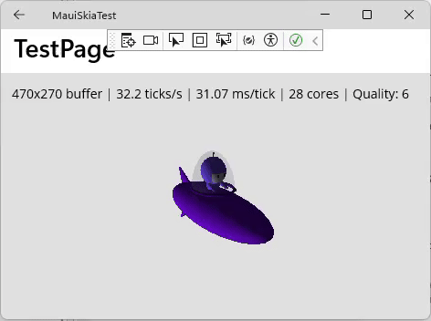

# MauiSkiaTest

A .NET MAUI experiment in rendering 3D models using **SkiaSharp**. The project explores drawing 3D meshes on a SkiaSharp canvas within a cross-platform MAUI application.

## Demo

*Animated GIF preview goes here.*

## 3D models

The models use the **Wavefront OBJ/MTL 3D standards**:

- **OBJ (`.obj`)** defines the model geometry, including vertices, normals, and polygon faces.
- **MTL (`.mtl`)** defines materials referenced by the OBJ file, including diffuse colors and opacity.

Bundled examples include a teapot, a Cessna aircraft, and the .NET bot. Model assets are stored in `MauiSkiaTest\Resources\Raw`.

This is an experimental renderer, not a full-featured 3D engine. The model loader supports geometry and basic material properties; texture rendering is not currently supported.
